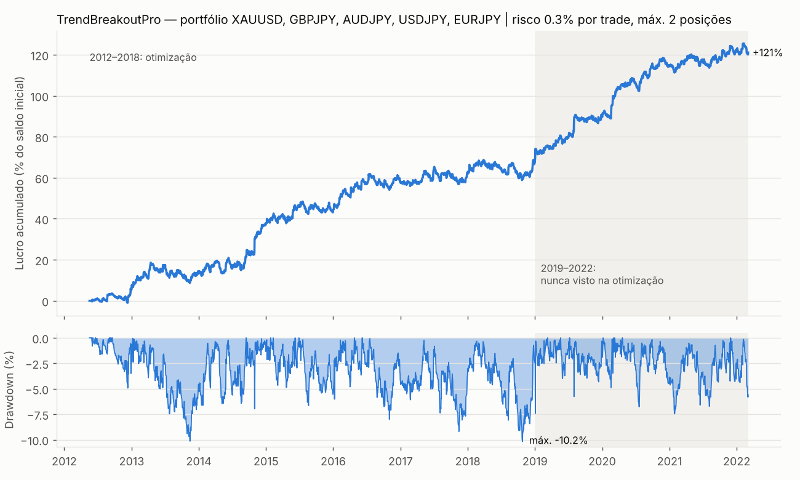

# TrendBreakoutPro — bot de trading para MetaTrader 5/4 e prop firms

Expert Advisor de **breakout de tendência em H1** que opera **ouro (XAUUSD) e os cruzados do iene
(GBPJPY, AUDJPY, USDJPY, EURJPY)**, com proteção de conta própria para contas financiadas
(FTMO e semelhantes). Toda a estratégia saiu de uma investigação com dados reais e **~40 000
backtests**, validada fora da amostra, contra entradas aleatórias, em walk-forward, com stress de
custos e em Monte Carlo.



> **Aviso honesto.** Não existe nenhum bot "100% eficaz". O que está aqui é uma vantagem
> estatística **pequena mas robusta** (Sharpe ≈ 1,2; ganha em ~35% dos trades, com lucro médio ≈ 2,3× a
> perda média), que se manteve em 2019–2022, um período que a otimização nunca viu. Resultados passados
> não garantem resultados futuros. Teste sempre primeiro numa conta demo e no Strategy Tester do seu broker.

---

## 1. A estratégia

| Regra | Valor |
|---|---|
| Timeframe | H1 (o EA lê sempre H1, seja qual for a carta) |
| Compra | fecho da barra **acima do máximo das 55 barras anteriores** e acima da **EMA 200** |
| Venda | fecho da barra **abaixo do mínimo das 55 barras anteriores** e abaixo da **EMA 200** |
| Horas | só aceita sinais de barras entre as **08h e as 22h** (hora do servidor GMT+2/+3) |
| Stop inicial | **2 × ATR(20)** |
| Take-profit | nenhum: os lucros correm |
| Trailing stop | "chandelier": melhor preço desde a entrada **− 5 × ATR(20)**, atualizado no fecho de cada barra |
| Sinal contrário | fecha e inverte |
| Sexta-feira | **fecha tudo às 22h** (sem risco de gap de fim de semana); não abre posições a partir das 20h |
| Limite de exposição | **máximo de 2 posições abertas** na conta inteira |
| Risco | % fixa do **saldo inicial** por trade (recomendado 0,25–0,30%) |

Porque funciona: o ouro e o iene são ativos de "refúgio/carry" que fazem tendências fortes durante
episódios de risco (e o seu desfazer). Nos pares em USD/EUR/GBP/CHF sem iene a mesma regra **perde
dinheiro**. Isso foi medido, e é por isso que eles não estão no bot.

## 2. Resultados (dados reais MT5, nov/2012 → mar/2022, com spread, comissão e slippage)

| | 2012–2018 (otimização) | **2019–2022 (nunca visto)** | Tudo |
|---|---|---|---|
| R por ano | 33,9 | **57,3** | 41,2 |
| Drawdown máx. (R, inclui flutuante) | 34,3 | **26,2** | 34,3 |
| Sharpe (diário) | 0,98 | **1,47** | 1,16 |

Com **0,3% de risco por trade**: ≈ **+12%/ano** e um drawdown máximo histórico do pico ao vale de
**−10,2%**. Todos os anos de 2012 a 2021 foram positivos (2022 só tem 2 meses de dados: −1,6%).

### Testes de robustez feitos (detalhe em [`reports/robustness.md`](reports/robustness.md))

| Teste | Resultado |
|---|---|
| Separação in-sample / out-of-sample | lucrativo nos dois períodos, e melhor no período nunca visto |
| Grelha de 875 combinações de parâmetros | 86% das combinações lucrativas no ouro tanto em IS como em OOS; planalto largo, sem "pico" |
| Contra **300 estratégias de entradas aleatórias** por símbolo | bate o aleatório nos 5 símbolos (p-valor 0,000–0,043) |
| **Walk-forward** (re-otimiza a cada 6 meses, testa no semestre seguinte) | +321 R só em períodos nunca vistos; positivo nos 5 símbolos |
| Barras H1 desfasadas 15/30/45 min | resultado praticamente igual (não depende do relógio das barras) |
| Spread ×2, slippage 0,5 pip, comissão ×1,5 | continua lucrativo (Sharpe 0,76–1,08) |
| Spread ×3 + slippage 1 pip | quase zero → **exige conta raw/ECN** |
| Monte Carlo block-bootstrap (10 000 anos sintéticos) | com 0,3%: retorno mediano +12,3%/ano, 11% de anos negativos, DD p95 13,9% |
| Paridade EA ↔ backtest | 0 sinais diferentes em mais de 11 000 sinais (`tests/test_ea_parity.py`) |

### Prop firms (detalhe em [`reports/propfirm.md`](reports/propfirm.md))

Desafios simulados a partir de cada semana de 2012 a 2022 sobre a sequência **real** de dias
(perda diária 5%, perda total 10%, sem limite de tempo):

| Risco/trade | Fase 1 (+10%) passa | Duração mediana | Fase 2 (+5%) passa | Conta financiada: violar em 12 meses | Lucro médio/ano |
|---|---|---|---|---|---|
| 0,20% | 100% | ~12 meses | 100% | 0% | +8,4% |
| 0,25% | 100% | ~10 meses | 100% | 0% | +10,5% |
| **0,30%** | **100%** | **~8 meses** | **100%** | **0%** | **+12,6%** |
| 0,40% | 96% | ~5 meses | 96% | 5% | +17,1% |
| 0,50% | 89% | ~3,5 meses | 89% | 12% | +22,2% |

(Valores para a regra diária tipo FTMO. Nas firmas que contam o lucro flutuante no limite diário, use
≤ 0,30%: acima disso as falhas diárias sobem depressa. Ver o relatório.)

**Recomendação:** 0,30% no desafio, e 0,25% na conta financiada. É **lento**: um desafio demora
meses, não dias. É esse o preço de não rebentar a conta. As firmas sem limite de tempo (FTMO, etc.)
são as indicadas.

## 3. Instalação no MetaTrader 5

1. No MT5: **Ficheiro → Abrir pasta de dados → `MQL5/Experts`** e copie `mql5/TrendBreakoutPro.mq5` para lá.
2. Abra o MetaEditor (F4), abra o ficheiro e carregue em **Compilar** (F7).
3. No MT5, ponha os 5 símbolos na **Observação de Mercado** (Market Watch).
4. Arraste o EA para **uma única carta** (por exemplo XAUUSD H1). O EA trata dos 5 símbolos sozinho.
5. Ative o **Algo Trading** e confirme na aba "Expertos" do diário que diz `TrendBreakoutPro iniciado`.

MetaTrader 4: o mesmo com `mql4/TrendBreakoutPro.mq4` em `MQL4/Experts` (sem filtro de notícias,
porque o MT4 não tem calendário económico).

### Parâmetros importantes

| Parâmetro | O que pôr |
|---|---|
| `InpSuffix` | sufixo dos símbolos do broker, se houver (ex.: `.r`, `m`, `.raw`). Se o ouro se chamar `GOLD`, edite `InpSymbols` |
| `InpRiskPct` | 0,30 no desafio, 0,25 na conta financiada |
| `InpInitialBalance` | saldo inicial da conta (ex.: 100000). Com 0, usa o saldo do primeiro arranque |
| `InpDailyLossPct` / `InpMaxLossPct` | as regras da sua firma (FTMO: 5 / 10) |
| `InpBufferPct` | margem: o EA fecha tudo e pára **antes** do limite real (1% por defeito) |
| `InpTargetPct` | meta do desafio (10 na fase 1, 5 na fase 2): o EA pára ao atingi-la |
| `InpDayResetHour` | hora do servidor em que a firma reinicia o dia (FTMO: meia-noite CE(S)T, ou seja, `1` num servidor GMT+2/+3) |
| `InpHourShift` | só se o servidor do broker **não** estiver em GMT+2/+3 (ex.: servidor GMT+0 → `2`) |
| `InpNewsFilter` | ligue se a sua firma proibir trades à volta de notícias (não foi testado no backtest) |

### Proteção prop firm incluída no EA

* Perda diária e total medidas na **equity** (inclui o flutuante), a cada segundo.
* Ao chegar a `limite − margem`: **fecha todas as posições** e pára (até ao dia seguinte, ou de vez no caso do limite total).
* O risco de cada trade nunca passa da perda que ainda falta até ao limite.
* O estado (saldo inicial, base do dia, paragens) fica guardado em variáveis globais do terminal, e por isso **sobrevive a reinícios**.
* Lote sempre arredondado **para baixo**; se o lote mínimo arriscar mais do que o pedido, o EA **não entra**.
* Filtro de spread (não entra se o spread for > 15% do ATR), novas tentativas em requotes, respeito do stops level, modo de preenchimento automático.
* Sem martingale, sem grid, sem médias de perdas, sem arbitragem de latência: nada do que as prop firms proíbem.

### Requisitos do broker

* **Conta raw/ECN** (spread baixo + comissão). Com spreads de conta "standard" a vantagem desaparece (ver stress de custos).
* Servidor em GMT+2/+3 (o padrão da FTMO, IC Markets, Pepperstone, FundedNext, etc.).
* Antes de usar dinheiro real, corra o EA no **Strategy Tester** (modo "Every tick based on real ticks") com os dados do seu broker e compare com estes relatórios.

## 4. Reproduzir a investigação

```bash
cd trading_bot
pip install -r requirements.txt
python get_data.py                       # descarrega os dados (2012-2022, M15/H1/H4/D1)
python tests/test_engine.py              # testes do motor de backtest
python tests/test_ea_parity.py           # paridade EA <-> backtest
python -m research.run_robust            # -> reports/robustness.md
python -m research.run_prop              # -> reports/propfirm.md
python -m research.plot_equity           # -> reports/equity.png
python -m research.run_explore trend     # grelhas exploratórias (também: pullback, bbrev, session)
python -m research.run_trend wide        # grelha larga do breakout (também: exits, filters)
```

| Ficheiro | Conteúdo |
|---|---|
| `research/engine.py` | motor barra-a-barra (numba): bid/ask, spread por hora, comissão, slippage, gaps, SL antes do TP na mesma barra, trailing só no fecho |
| `research/pengine.py` | motor de portfólio multi-símbolo com limite de posições, igual ao EA |
| `research/strategies.py` | as 4 famílias testadas (tendência, pullback RSI, reversão Bollinger, breakout de sessão) |
| `research/robustness.py` | Monte Carlo, entradas aleatórias, stress de custos, walk-forward |
| `research/portfolio.py` | curva de capital e simulação de regras de prop firm |
| `research/config.py` | a configuração final (= valores por defeito do EA) |

## 5. O que foi testado e rejeitado

Fica registado para não ser repetido:

* **Breakout de tendência em pares USD/EUR/GBP/CHF** (EURUSD, GBPUSD, USDCHF, USDCAD, AUDUSD, EURGBP, EURCHF): perde em quase todas as combinações de parâmetros.
* **Pullback RSI(2–5) em tendência** (H1/H4/D1): sem vantagem consistente depois de custos.
* **Reversão à média com Bandas de Bollinger** em M15/H1, incluindo o "scalping" da sessão asiática: 0% das combinações lucrativas fora da amostra; os custos comem a margem.
* **Breakout da sessão de Londres** (range asiático): negativo na maioria dos pares.
* **Take-profit fixo, break-even, saída por tempo, filtro ADX**: pioram ou não acrescentam nada.
* **Sazonalidade intradiária do ouro** (sobe na sessão asiática em 11 de 11 anos): real, mas pequena demais para pagar o spread.

## 6. Limitações

* Os dados acabam em março de 2022 (fonte pública gratuita). O desempenho de 2022 em diante não foi medido aqui: valide no Strategy Tester do seu broker com dados recentes.
* A escolha do cesto (ouro + iene) teve em conta todo o histórico. O walk-forward e a seleção de símbolos com dados apenas passados atenuam, mas não eliminam, esse viés.
* O código MQL não pôde ser compilado neste ambiente (o MetaEditor não está disponível aqui). A lógica foi verificada contra o backtest, mas se a compilação der algum aviso ou erro, envie-me a mensagem.
* Ganha só ~35% dos trades: haverá sequências de 10–15 perdas seguidas. Isso é normal nesta estratégia, e não é razão para mexer nos parâmetros.
